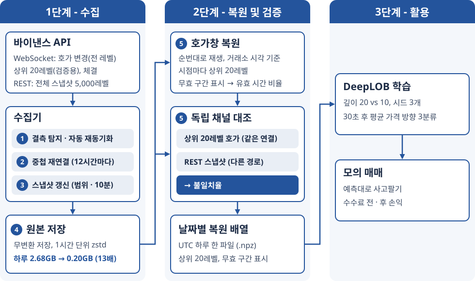

# Tickfold

비트코인 호가창 스트림을 빠짐없이 모으고, 모은 데이터가 맞는지를 측정한 수치로 보이는 수집기다. 바이낸스 현물 BTCUSDT 를 2026-09-27 부터 모으고 있고, 그 데이터로 호가창 예측 모델(DeepLOB)을 학습하는 데까지 이어 붙였다.

*Design and Implementation of a High-Frequency Order Book Data Collector for Bitcoin Price Prediction*



## 무엇을 하나

1. **수집.** 웹소켓 하나로 호가 변경(델타, 100ms 묶음), 체결, 검증용 상위 20레벨을 받고, REST 로 상위 5,000레벨 스냅샷을 따로 받는다. 받은 바이트를 그대로 1시간마다 zstd 로 압축해 저장한다. 메시지 순번이 끊기면 갭으로 기록하고 스냅샷으로 다시 맞춘다. 거래소가 48시간쯤마다 연결을 끊으므로, 12시간마다 새 연결을 먼저 열어 같이 받은 뒤 넘겨받는다.
2. **복원과 검증.** 저장한 원본을 순번대로 다시 재생해 프레임마다 상위 20레벨 배열을 만든다. 이것을 거래소가 따로 주는 상위 20레벨(같은 연결)과 REST 스냅샷(다른 경로)에 견줘 불일치율을 재고, 갭과 재동기화 대기를 뺀 시간 비율(커버리지)을 잰다.
3. **학습.** 복원한 배열로 DeepLOB 을 학습해 30초 뒤 가격 방향(내림·보합·오름)을 예측하고, 입력 레벨 수(20·10·5·1)에 따른 차이를 본다. 그 예측대로 사고팔았다고 치고 수수료 전·후 손익을 센다.

## 결과

2026-09-27 ~ 10-16(UTC 날짜 20개) 결과다. 표와 그림, 근거 파일은 [`docs/results.md`](docs/results.md) 에 있다.

| 항목 | 결과 |
|---|---|
| 결측(갭) | 12곳, 합계 153.7초. 12곳 모두 자동으로 재동기화됐다 |
| 믿을 수 있는 시간 비율 | 99.9904% (갭과 재동기화 대기를 뺀 시간) |
| 상위 20레벨 대조 | 스냅샷 범위 안 16,824,983시점에서 불일치 0. 전체 기간은 불일치 시점 0.0214% 이고 거의 전부 스냅샷 갱신 규칙을 넣기 전인 09-28 에 있다 |
| 72시간 무중단 판정 | 재시작 0회, 미복구 갭 0회, 불일치율 0.01% 미만, 믿을 수 있는 시간 99.9% 이상. 네 기준 모두 통과 |
| DeepLOB 평가 정확도 | 0.562 ~ 0.564 (입력 20·10·5·1레벨). 모델 없는 단순 규칙 0.516, 늘 보합 0.341 |
| 모의 매매 | 거래당 수수료 전 +1.45 ~ +1.50bp, 왕복 수수료 20bp 를 빼면 −18.5bp |

데이터 품질은 "오차 없음" 이 아니라 측정한 불일치율과 커버리지로 말한다.

## 구조

```
tickfold/
  collector/       수집기. 순번 검증, REST, 원본 저장, 스트림 수집과 재동기화, 연결 교대, 진입점
  replay/          복원기. 파일 순서, 재생, 상위 N 추출, valid 마스크와 커버리지, depth20·REST 대조, 날짜별 배열
  model/           DeepLOB 학습. 설정, 입력, 라벨, 모델, 학습, 평가
  paper_trading/   모의 매매. 매매 규칙, 손익, 기준선, 예측 읽기
  screen/          학술제 시연용 호가창 재생 화면(Streamlit)
scripts/           날짜별 복원과 합계, 깊이별 학습, 모의 매매, 재생 화면용 구간 내보내기, 픽스처 캡처
tests/             pytest 145개. 네트워크 없이 픽스처로 돈다
deploy/            수집기 systemd 사용자 유닛
docs/              결과, 계획, 분석 보고서, 포스터 그림
results/           docs/results.md 의 숫자 근거 파일
```

## 실행

Python 3.12 이상과 [uv](https://docs.astral.sh/uv/) 가 있어야 한다.

```bash
uv sync
uv run pytest -q
```

학습·그림·재생 화면 패키지는 dependency group 으로 나눠 두었다(`model`, `figures`, `screen`). 그 그룹을 안 깔면 그 그룹을 쓰는 시험은 건너뛴다.

수집기는 `.env.example` 을 `.env` 로 복사한 뒤 띄운다. 서비스로 돌리려면 `deploy/tickfold-collector.service` 를 쓴다.

```bash
cp .env.example .env
uv run --env-file .env python -m tickfold.collector.main
```

모은 원본에서 날짜별 배열을 만들고 합계를 낸다. 끝난 UTC 날짜만 받는다.

```bash
uv run python scripts/restore_days.py restore 2026-09-27 2026-10-16
uv run python scripts/restore_days.py summarize
```

학습은 CUDA GPU 에서 돌렸다(RTX 4080 한 장). 평가 구간은 설정을 다 정한 뒤 `--evaluate` 를 준 실행에서만 채점한다. 모의 매매는 학습이 쓴 예측 파일을 읽는다.

```bash
uv run --group model python scripts/train_deeplob.py --evaluate
uv run --group figures python scripts/paper_trading.py --predictions runs/deeplob/depth20-seed0/predictions.npz --figure runs/deeplob/depth20-seed0/paper_trading.png
```

재생 화면은 미리 내보낸 구간 파일만 읽는다. 시각은 UTC 거래소 시각이고 구간은 2시간까지다.

```bash
uv run python scripts/export_replay_segment.py 2026-10-07T07:25:00 2026-10-07T07:40:00 segments/gap-0732.npz
uv run --group screen streamlit run tickfold/screen/app.py
```

## 데이터

원본 시장 데이터는 바이낸스 공개 스트림에서 모았고 이 저장소에 다시 배포하지 않는다. 저장소에는 파생 통계와 결과 파일([`results/`](results/))만 있다.

## 문서

- [`docs/results.md`](docs/results.md): 실험 결과. 수집, 갭, 대조, 72시간 판정, DeepLOB 깊이 비교, 모의 매매, 밝혀 둘 것
- [`docs/build-plan-v2.md`](docs/build-plan-v2.md): 살아 있는 계획. 설계 결정과 실측 기록, 알려진 결함 구간 표
- [`docs/analysis-2026-10-12-sprint-to-showcase.md`](docs/analysis-2026-10-12-sprint-to-showcase.md): 복원기·대조·모델 착수 전 분석 보고서
- [`docs/analysis-2026-09-15-v2-transition.md`](docs/analysis-2026-09-15-v2-transition.md): 데이터 품질 검증 방법을 정한 분석 보고서
- [`docs/showcase-recording.md`](docs/showcase-recording.md): 학술제 재생 화면 녹화 절차
- [`docs/build-plan-v1.md`](docs/build-plan-v1.md): 보류한 v1 계획(저장 포맷과 벤치마크)

다음 연구는 복원한 호가창 위에서 주문 체결을 모사하는 시뮬레이터와, 깊이·수량 정밀도·가격 정밀도·시간 해상도를 줄였을 때 저장 용량과 예측 정확도가 어떻게 바뀌는지 재는 실험이다.

## 라이선스

MIT. [`LICENSE`](LICENSE) 를 본다.

## 인용

이 수집기의 설계와 구현을 다룬 논문을 준비하고 있다. 나오면 인용 정보를 여기에 적는다.
