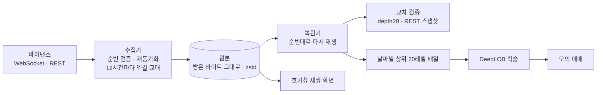

# Tickfold

> 비트코인 호가창을 빠짐없이 모으고, 제대로 모았는지 숫자로 증명하는 수집기



## 소개

가격 예측 모델은 호가창 데이터로 학습하는데, 거래소는 호가창 전체가 아니라 바뀐 부분만 100ms마다 보낸다. 메시지 하나만 놓쳐도 그 뒤 호가창이 틀어지고, 연결은 이틀마다 끊기고, 스냅샷은 5,000레벨에서 잘린다. Tickfold 는 바이낸스 BTCUSDT 호가 스트림을 끊김 없이 모으고, 모은 데이터를 거래소의 다른 채널과 맞춰 봐서 얼마나 맞는지를 수치로 낸다. 그 데이터로 DeepLOB 을 학습하는 데까지 이어 붙였다.

- 기간: 2026.09 ~ 2026.11 (수집은 2026-09-27 부터 계속 돌고 있다)
- 형태: 개인 졸업 연구

## 기술 스택

| 영역 | 스택 |
|---|---|
| 수집 | Python 3.12, asyncio, websockets, aiohttp, zstandard |
| 복원·검증 | NumPy |
| 모델 | PyTorch, scikit-learn |
| 화면·그림 | Streamlit, Plotly, Matplotlib |
| 운영·시험 | systemd, uv, pytest (시험 145개, 네트워크 없이 돈다) |

## 주요 기능

- **끊김 없는 수집**: 12시간마다 새 연결을 먼저 열어 3초 넘게 같이 받은 뒤 넘겨받는다. 거래소의 강제 종료로 생기던 8~9초 결측이 없어졌다.
- **결측 감지와 자동 복구**: 메시지 순번이 끊기면 갭으로 기록하고, 스냅샷을 다시 받아 호가창을 맞춘다.
- **원본 그대로 저장**: 받은 바이트를 손대지 않고 1시간마다 압축한다. 하루 2.68GB 가 0.20GB 가 된다.
- **호가창 복원과 교차 검증**: 원본을 다시 재생해 상위 20레벨을 만들고, 거래소가 따로 주는 상위 20레벨·REST 스냅샷과 맞춰 본다.
- **DeepLOB 학습과 모의 매매**: 30초 뒤 가격 방향을 예측하고, 입력 레벨 수(20·10·5·1)에 따라 달라지는지 본다. 예측대로 사고팔았을 때 손익도 센다.
- **호가창 재생 화면**: 저장한 구간을 브라우저에서 거래소 시각대로 다시 틀어 본다. 학술제 발표 영상을 이 화면으로 찍었다.

## 결과

2026-09-27 ~ 10-16, 20일치다. 자세한 표와 근거 파일은 [`docs/results.md`](docs/results.md) 에 있다.

| 항목 | 결과 |
|---|---|
| 결측 | 12곳, 합계 153.7초. 전부 자동 복구 |
| 쓸 수 있는 시간 비율 | 99.9904% |
| 상위 20레벨 대조 | 스냅샷 범위 안 1,682만 시점에서 불일치 0 |
| REST 스냅샷 대조 | 범위 안 2,587만 레벨에서 불일치 0 |
| 72시간 무중단 판정 | 재시작 0회, 미복구 결측 0회. 네 기준 모두 통과 |
| DeepLOB 정확도 | 56.2 ~ 56.4% (단순 규칙 51.6%, 늘 보합 34.1%) |
| 모의 매매 | 거래당 수수료 전 +1.5bp, 수수료 뒤 −18.5bp |

입력을 20레벨에서 1레벨로 줄여도 정확도는 그대로였다. 예측력은 있지만 30초 앞을 맞혀서는 수수료(왕복 20bp)를 넘지 못한다.

## 트러블슈팅

### 1. 거래소가 이틀마다 연결을 끊는다

- **문제**: 연결이 48시간쯤 지나면 거래소가 끊고, 그때마다 8~9초가 빈다. 문서에 있는 종료 예고(`serverShutdown`)는 8일 동안 세 번 끊기는 사이 한 번도 오지 않았다.
- **해결**: 끊기기 전에 먼저 갈아탄다. 12시간마다 새 연결을 열어 두 연결로 3초 넘게 같이 받고, 새 연결이 옛 연결이 준 데까지 다 받았는지 확인한 뒤 넘겨받는다. 파일에 쓰는 연결은 늘 하나라서 원본이 두 벌이 되지 않는다.
- **결과**: 실제 스트림으로 교대 136회를 돌려 빠진 것 0, 두 번 쓴 것 0. 배포한 뒤로 교대 19회 모두 결측 없이 넘어갔다.

### 2. 스냅샷 범위 밖 주문이 사라진다

- **문제**: 수집 이틀째, 복원한 호가창에서 거래소 값보다 레벨이 빠진 시점이 3,628개 나왔다.
- **원인**: REST 스냅샷은 1호가에서 5,000레벨까지만 준다. 가격이 크게 움직여 그 밖으로 나가면, 범위 밖에 가만히 있던 주문은 바뀌기 전까지 델타에도 안 나와서 알 수가 없다. 빠진 가격은 전부 범위 밖이었고 수량이 틀린 레벨은 0 이었다.
- **해결**: 범위 끝까지 남은 폭이 20% 아래로 줄거나 마지막 스냅샷이 10분보다 오래되면 스냅샷을 다시 받는다.
- **결과**: 그 뒤 18일 동안 불일치는 급락 순간의 3시점뿐이다.

### 3. 결측 길이가 실제보다 짧게 잡힌다

- **문제**: 같은 끊김이 받은 시각으로는 3.0초인데 거래소가 찍은 시각으로는 24.9초였다.
- **원인**: 끊기기 전 연결이 이미 20초 넘게 밀려 있었다. 그동안 받은 프레임은 전부 옛 것이라, 받은 시각으로 재면 빈 시간이 거의 없어 보인다.
- **해결**: 시간 축을 받은 시각이 아니라 거래소 시각으로 잡았다. 결측 길이와 쓸 수 있는 시간 비율도 전부 거래소 시각으로 잰다.

### 4. 복원할 때 멀쩡한 구간이 결측으로 나온다

- **문제**: 스냅샷을 받은 시각 자리에 끼워 재생하니 프레임의 29.8% 가 결측 뒤 구간으로 처리됐다.
- **원인**: 스냅샷의 25.7% 가 자기보다 뒤 순번의 프레임이 저장된 다음에 도착했다. 받은 시각으로 끼우면 순번이 맞지 않아 가짜 결측이 된다.
- **해결**: 스냅샷의 순번(`lastUpdateId`)을 보고 맞는 프레임 앞에 끼운다.
- **결과**: 가짜 결측이 0 이 됐다. 20일 동안 동기화가 안 된 프레임은 97개이고, 전부 수집 첫 스냅샷 전이나 실제 결측 바로 뒤다.

### 5. 라벨이 답을 미리 알려 준다

- **문제**: DeepLOB 원 논문이 런던 증권거래소 데이터에 쓴 라벨로 만들어 보니, 모델 없이 규칙 하나로 정확도 78% 가 나왔다. 방향 정보를 지운 가짜 시계열에서도 75% 였다.
- **원인**: 그 라벨은 앞뒤 구간 평균의 차라서, 변화량의 절반이 이미 입력 창 안에 있다.
- **해결**: 지금 가격과 앞으로 30초 평균을 견주는 FI-2010 방식으로 바꿨다. 같은 규칙의 정확도가 48 ~ 57% 로 내려왔다.

### 6. 재생 화면이 프레임마다 깜빡인다

- **문제**: Streamlit 에서 그림을 다시 그리며 재생하니 프레임마다 화면이 깜빡였다.
- **원인**: Streamlit 1.65 는 그림 내용으로 그림 ID 를 만들어서, 값이 바뀔 때마다 그림을 지우고 새로 그린다.
- **해결**: 구간 배열을 브라우저에 한 번 보내고, 재생과 그리기를 브라우저 쪽 자바스크립트로 옮겼다. 그림은 지우지 않고 값만 바꾼다.

## 실행 방법

Python 3.12 이상과 [uv](https://docs.astral.sh/uv/) 가 필요하다.

```bash
uv sync
uv run pytest -q
```

수집기

```bash
cp .env.example .env
uv run --env-file .env python -m tickfold.collector.main
```

복원, 학습, 모의 매매 (모은 원본이 있어야 하고, 학습은 CUDA GPU 에서 돌렸다)

```bash
uv run python scripts/restore_days.py restore 2026-09-27 2026-10-16
uv run python scripts/restore_days.py summarize
uv run --group model python scripts/train_deeplob.py --evaluate
uv run --group figures python scripts/paper_trading.py --predictions runs/deeplob/depth20-seed0/predictions.npz --figure runs/deeplob/depth20-seed0/paper_trading.png
```

재생 화면

```bash
uv run python scripts/export_replay_segment.py 2026-10-07T07:25:00 2026-10-07T07:40:00 segments/gap-0732.npz
uv run --group screen streamlit run tickfold/screen/app.py
```

원본 시장 데이터는 저장소에 올리지 않는다. 결과 숫자의 근거 파일은 [`results/`](results/) 에 있다.

## 폴더 구조

```
tickfold/
  collector/       수집기
  replay/          복원기와 교차 검증
  model/           DeepLOB 학습
  paper_trading/   모의 매매
  screen/          호가창 재생 화면
scripts/           복원, 학습, 모의 매매, 구간 내보내기
tests/             pytest
deploy/            systemd 유닛
docs/              결과, 계획, 분석 보고서, 포스터 그림
results/           결과 근거 파일
```

## 문서

- [실험 결과](docs/results.md)
- [구현 계획과 실측 기록](docs/build-plan-v2.md)
- [학술제 재생 화면 녹화 절차](docs/showcase-recording.md)

## 라이선스

MIT
