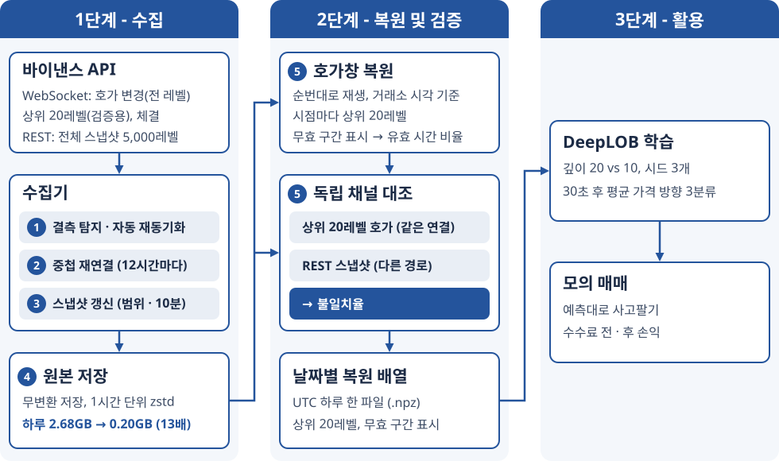
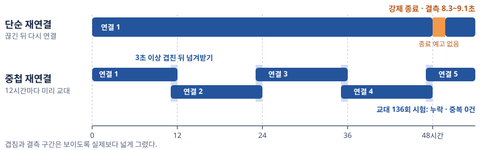
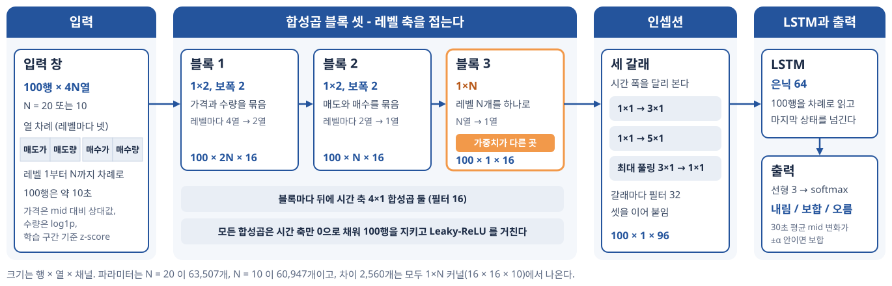
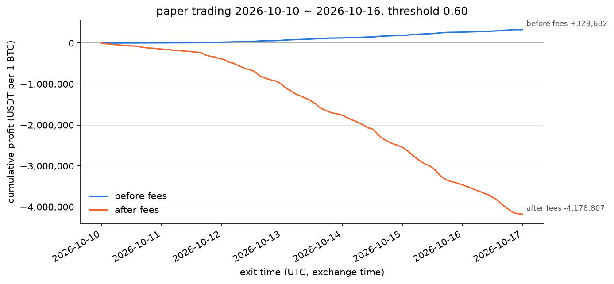

# 실험 결과

바이낸스 BTCUSDT 호가 스트림을 20일 동안 모은 결과다. 데이터가 빠짐없이 왔는지, 받은 데이터가 맞는지, 그 데이터로 예측 모델을 학습할 수 있는지를 차례로 본다. 결과 표의 숫자는 [`results/`](../results/) 의 파일로 다시 확인할 수 있다. 갭의 시작 시각과 원인, 재시작 판정에 쓴 수집기 로그는 [`docs/build-plan-v2.md`](build-plan-v2.md) 1절 결함 구간 표와 맨 위 판정 기록이 근거다. 로그 사본은 서버 이름이 들어 있어 올리지 않았고, 교대 줄만 서버 이름을 빼고 [`results/rotations.txt`](../results/rotations.txt) 에 옮겼다. 원본 시장 데이터는 공개하지 않는다.

시각은 따로 적지 않으면 UTC 거래소 시각이다.

**용어.** 호가창은 가격마다 걸린 매수·매도 주문 수량의 목록이고, 가격 하나가 레벨이다. 가장 비싼 매수가와 가장 싼 매도가가 1호가이고, 둘의 평균이 mid, 차이가 스프레드다. 가격의 최소 단위(1틱)는 0.01 USDT, 1bp 는 0.01% 다. 거래소는 호가창 전체 대신 100ms 동안 바뀐 레벨의 새 수량(델타)을 묶어 보낸다. 이 메시지 하나가 프레임이고, 복원한 배열에서 한 행이 된다. 호가창 전체 사본(스냅샷)은 따로 받는데 1호가에서 5,000레벨까지만 준다. 그 가격 구간(스냅샷 범위) 밖에 있던 주문은 바뀌기 전까지 델타에도 안 나와서 알 수 없다. 메시지를 놓친 구간이 갭이고, 갭 뒤 새 스냅샷으로 호가창을 다시 맞추는 것이 재동기화다.

## 한눈에 보기

| 항목 | 결과 |
|---|---|
| 기간 | 2026-09-27 07:07 ~ 10-17 00:00, UTC 날짜 20개(19.7일, 1,702,378초) |
| 결측(갭) | 12곳, 합계 153.7초. 12곳 모두 자동으로 재동기화됐다 |
| 믿을 수 있는 시간 비율 | 99.9904% (갭과 재동기화 대기를 뺀 시간) |
| 상위 20레벨 대조 | 스냅샷 범위 안 16,824,983시점에서 불일치 0. 전체 기간은 불일치 시점 0.0214% 이고, 3,631시점 가운데 3,628시점이 스냅샷 갱신 규칙을 넣기 전인 09-28 의 범위 이탈이다 |
| REST 스냅샷 대조 | 2,655개, 스냅샷 범위 안 25,873,007레벨에서 불일치 0 |
| 72시간 무중단 판정 | 재시작 0회, 미복구 갭 0회, 불일치율 0.01% 미만, 믿을 수 있는 시간 99.9% 이상. 네 기준 모두 통과(4절) |
| 예측 모델(DeepLOB) | 30초 뒤 가격 방향(내림·보합·오름) 3분류 정확도 0.562 ~ 0.564(입력 레벨 수 20·10·5·1). 모델 없는 단순 규칙 0.516, 늘 보합 0.341 |
| 모의 매매 | 예측대로 사고판 거래당 손익이 수수료 전 +1.45 ~ +1.50bp, 왕복 수수료 20bp 를 빼면 −18.5bp 로 손실 |

## 1. 무엇을 모았나

- 바이낸스 현물 BTCUSDT 한 종목이다. 웹소켓 하나로 스트림 셋을 받는다. 델타(100ms 묶음, 모든 레벨), 체결, 검증용 상위 20레벨(이하 depth20, 100ms)이다. 여기에 REST 스냅샷(상위 5,000레벨)을 따로 받는다.
- 원본은 받은 바이트 그대로 1시간마다 zstd 로 압축해 저장한다. 위 기간의 원본은 압축 전 52.4GB, 압축 뒤 3.98GB(13.2배)다. 하루 단위로는 2.68GB 가 0.20GB 가 된다(수집 첫날을 뺀 19일 평균).
- 델타만으로는 호가창이 안 나오므로, 복원기가 스냅샷에서 시작해 원본 델타를 순번대로 다시 적용하며 프레임마다 상위 20레벨을 한 행으로 뽑는다. 날짜 하나에 0.58GB 배열 하나가 나오고, 20일치 16,959,557행(11GB)을 프로세스 넷으로 7분 39초에 만든다.

## 2. 데이터가 빠짐없이 왔나

델타 메시지마다 첫 순번 `U` 와 마지막 순번 `u` 가 붙는다. 새 메시지의 `U` 가 직전 `u` 다음 번호가 아니면 그 사이를 놓친 것이고, 이것이 갭이다. 복원기는 저장된 메시지의 순번을 이어 보며 갭을 찾는다. 수집기가 남긴 갭 기록 11줄과 하나씩 맞고, 09-28 06:25 재시작은 재시작 뒤 순번을 잇는 코드를 넣기 전이라 수집기가 몰랐다. 길이는 거래소가 찍은 시각 `E` 로 쟀다. 전달이 밀린 연결은 끊기기 전에 받은 프레임이 이미 20초쯤 늦은 것이라, 수신 시각으로 재면 갭이 짧게 나온다(10-07 07:32 은 수신 시각 3.0초, 거래소 시각 24.9초).

| 갭 시작 | 길이 | 재동기화까지 | 원인 |
|---|---|---|---|
| 09-28 06:25:00.414 | 9.0초 | 0.9초 | 수집기 재시작(코드 배포) |
| 09-28 08:01:27.114 | 1.5초 | 0.7초 | 수집기 재시작(코드 배포) |
| 09-30 08:18:01.814 | 9.1초 | 0.7초 | 거래소의 강제 종료(연결 48.3시간째) |
| 10-02 09:02:02.014 | 8.5초 | 0.6초 | 거래소의 강제 종료(48.7시간째) |
| 10-04 09:41:01.714 | 8.3초 | 0.6초 | 거래소의 강제 종료(48.6시간째) |
| 10-06 05:14:39.014 | 1.8초 | 0.8초 | 수집기 재시작(겹치기 재연결 배포) |
| 10-07 07:32:00.014 | 24.9초 | 1.0초 | 전달이 22초까지 밀린 뒤 핑 응답 시간 초과로 끊김 |
| 10-07 09:21:33.014 | 34.6초 | 1.2초 | 같은 종류. 전달이 32초까지 밀렸다 |
| 10-09 04:56:59.914 | 1.3초 | 0.6초 | 닫기 프레임 없이 TCP 가 끊김 |
| 10-09 09:33:00.014 | 1.3초 | 0.6초 | 같은 종류 |
| 10-15 02:25:02.114 | 30.1초 | 0.9초 | 전달이 밀린 뒤 핑 응답 시간 초과로 끊김 |
| 10-15 02:27:11.314 | 23.3초 | 1.0초 | 같은 종류. 전달이 20.8초까지 밀렸다 |

- 거래소는 연결을 48시간쯤마다 강제로 끊고, 그때마다 8~9초가 빈다. 수집기는 12시간마다 새 연결을 먼저 열어 3초 넘게 두 연결로 같이 받은 뒤, 새 연결이 저장을 넘겨받는다(겹치기 재연결. 아래 그림의 '중첩 재연결'). 10-06 에 이 코드를 올린 뒤로 강제 종료에 따른 갭은 없고, 10-16 끝까지 교대 19회가 전부 갭 없이 넘어갔다(겹친 시간 3.7 ~ 3.9초).
- 10-06 뒤에 남은 갭 여섯은 전부 예고 없이 끊긴 경우다. 미리 알 수 없어서 겹칠 수 없다.

**커버리지.** 전체 시간에서 못 쓰는 시간을 셋으로 나눠 뺐다. 갭, 갭이 아닌데 동기화가 안 된 시간(갭 뒤 재동기화 대기와 수집 첫 스냅샷 전), 동기화됐지만 20번째 레벨이 마지막 스냅샷 범위 밖인 시간이다. 갭 동안에는 행이 없으므로 행 수가 아니라 `E` 간격으로 잰다.

| 창 | 길이 | 갭 | 동기화 안 됨 | 범위 밖 | 갭만 뺀 비율 | 재동기화까지 뺀 비율 | 범위 밖까지 뺀 비율 |
|---|---|---|---|---|---|---|---|
| 전체 기간 | 1,702,378.4초 | 153.7초 | 9.7초 | 13,453.4초 | 99.9910% | **99.9904%** | 99.2001% |
| 72시간 판정 창 | 259,200.0초 | 60.8초 | 3.6초 | 0.0초 | 99.9765% | **99.9752%** | 99.9752% |

- 72시간 창의 동기화 안 됨 3.6초에는 창 바로 앞 재시작 갭(10-06 05:14, 창 밖) 뒤의 대기 0.8초가 들어 있다. 창 안 갭 셋의 대기는 2.8초다.
- 범위 밖 13,453.4초 가운데 10-14 12:30:43 의 0.3초를 뺀 나머지가 09-28 02:03 ~ 06:25 다. 스냅샷 갱신 규칙을 넣기 전이라 스냅샷이 하나뿐이던 때다(3절).

## 3. 받은 데이터가 맞나

갭 없이 받아도 델타를 잘못 적용하면 호가창이 틀어진다. 순번만 봐서는 이것을 못 잡는다. 그래서 복원한 호가창을 거래소가 따로 주는 두 채널과 견줬다.

- **depth20**: 거래소가 같은 연결로 주는 상위 20레벨이다. depth20 프레임의 순번 `lastUpdateId` 가 델타 프레임의 `u` 와 같은 행(이하 시점)마다 두 쪽 상위 20을 가격끼리 맞춰 본다. 같은 연결로 온 같은 거래소 값이라 우리 쪽 처리(델타 적용, 갭 판정, 스냅샷을 끼우는 자리, 상위 20 뽑기)는 검증하지만 거래소 피드 자체가 맞는지는 못 본다.
- **REST 스냅샷**: 웹소켓이 아니라 HTTP 요청으로 받은 상위 5,000레벨이다. 재생 중 새 스냅샷으로 호가창을 갈아 끼우기 직전에, 델타로 이어 온 호가창과 그 스냅샷을 견준다. 21번째 레벨부터는 이 대조만 근거다.

| 대조 | 견준 양 | 불일치 |
|---|---|---|
| depth20, 스냅샷 범위 안 | 16,824,983시점, 672,999,320레벨 | 0 |
| depth20, 범위를 벗어난 시점 | 134,476시점, 5,379,040레벨 | 3,631시점(2.70%), 7,073레벨 누락 |
| depth20 전체 | 16,959,459시점, 678,378,360레벨 | 3,631시점(**0.0214%**), 7,073레벨 누락(0.00104%) |
| REST 스냅샷, 범위 안 | 2,655개, 25,873,007레벨 | 0 |

- 시점 수는 16,959,557행에서 동기화 안 된 97행과 depth20 짝이 없는 1행을 뺀 것이다.
- 불일치율은 레벨이 아니라 시점으로 센다. 학습은 한 행의 20레벨을 통째로 넣어서, 한 레벨만 틀려도 그 행은 틀린 것이다.
- 틀린 3,631시점은 전부 레벨이 빠진 것이고, 빠진 가격은 전부 스냅샷 범위 밖이다. 수량이 다른 레벨과 우리 쪽에만 있는 레벨은 0 이다. 스냅샷 범위 밖에서 가만히 있던 주문은 알 수 없어서 생긴 관측 한계이고, 델타 적용의 잘못이 아니다.
- 전체 기간 0.0214% 는 72시간 판정 기준(0.01% 미만)을 넘는다. 3,631시점 가운데 3,628시점이 09-28 02:03 ~ 06:25 다. 이 구간을 보고 "1호가에서 스냅샷 범위 끝까지 남은 폭이 스냅샷을 받을 때의 20% 아래로 줄거나 마지막 스냅샷이 10분보다 오래되면 다시 받는다" 는 갱신 규칙을 넣었다. 그 뒤로는 10-14 12:30:43 의 3시점뿐이다. 가격이 0.3초 사이 112 USDT 떨어져, 새 스냅샷이 끼기 전 세 프레임에서 범위를 벗어났다.
- 대조가 틀린 복원을 실제로 잡는지 보려고, 시제품 대조에 일부러 틀리게 만든 복원 여섯 가지를 넣어 봤고 전부 잡혔다. 깊은 레벨만 틀리게 한 경우는 depth20 대조가 9.4% 시점만 잡고 REST 스냅샷 대조가 전부 잡았다. 이 변이 하나는 본 구현 대조에도 10-08 하루에 넣어 같은 결과를 봤다.

## 4. 72시간 무중단 판정

수집기가 72시간 동안 끊김 없이 돈다고 말할 수 있는지를 미리 정한 네 기준으로 판정했다. 판정 창은 겹치기 재연결 코드를 올리고 다시 띄운 뒤 처음 저장된 프레임부터 72시간이다(10-06 05:14:40.814 ~ 10-09 05:14:40.814). 배포 시각으로 정해지는 창이다. 10-12 에 후보 창 셋의 갭을 잰 뒤 이 창을 골랐고, 셋 가운데 갭이 가장 많은 창이다.

| 기준 | 결과 |
|---|---|
| 프로세스 재시작 0회 | 0회. 창 안의 수집기 로그 868줄이 전부 같은 프로세스이고, systemd 의 시작·종료 기록이 없다 |
| 미복구 갭 0회 | 갭 3회(24.9초, 34.6초, 1.3초)가 각각 갭 뒤 1.0초, 1.2초, 0.6초 만에 자동으로 재동기화됐다 |
| 상위 20레벨 불일치율 0.01% 미만(시점 기준) | 0. depth20 2,584,109시점과 REST 스냅샷 424개 모두 불일치 0 이고, 창 안에 스냅샷 범위 밖 시점은 없다 |
| 믿을 수 있는 시간 비율 99.9% 이상 | 99.9752%. 갭과 재동기화 대기 64.4초를 뺐다 |

- 믿을 수 있는 시간 비율을 10-06 배포 뒤부터 10-16 끝까지 1분씩 민 72시간 창 11,206개에서 재면 전부 99.9% 를 넘는다. 가장 나쁜 창도 65.5초를 빼서 99.9747% 이고, 갭이 하나도 없는 창이 3,892개(34.7%)다. 판정 창보다 나은 창이 88.2% 라 판정 창은 나쁜 쪽에 든다.

## 5. 예측 모델 학습: DeepLOB 깊이 비교

복원한 상위 20레벨로 호가창 예측 모델 DeepLOB(Zhang et al., 2019. 합성곱 + LSTM)을 학습해, 입력 깊이(레벨 수)에 따라 30초 뒤 가격 방향 예측이 달라지는지 봤다. 목적은 높은 정확도가 아니라, 이 데이터로 학습이 되는지와 깊이에 따른 상대적 차이를 보는 것이다. 깊이 20 과 10 으로 시작했고, 둘의 차이가 시드 편차 안으로 나온 뒤 지도교수 의견으로 5 와 1 을 더했다.

그림은 학술제 포스터용이라 깊이 20·10 만 적었다. 깊이 5·1 도 구조가 같고 1×N 커널만 다르다.

**설정**

| 항목 | 값 |
|---|---|
| 입력 | 직전 100행(약 10초). 레벨마다 매도가·매도량·매수가·매수량. 가격은 그 행 mid 기준 상대값, 수량은 log1p, 학습 구간 통계로 z-score 한 뒤 ±10 에서 자른다 |
| 라벨 | 앞으로 30초(거래소 시각) 동안 mid 평균과 지금 mid 의 상대 차이 l. 보합 폭 α 는 학습 표본 \|l\| 의 1/3 분위수(2.164e-5, 약 1.83 USDT)이고 l 이 −α 아래면 내림, α 위면 오름, 사이면 보합 |
| 기간 | 학습 09-27 ~ 10-06(10일), 검증 10-07 ~ 10-09(3일), 평가 10-10 ~ 10-16(7일). 시간 순서대로 자른다 |
| 표본 | 날짜 파일 행 번호가 10의 배수인 행. 입력 창이나 라벨 구간이 갭, 쓸 수 없는 행(동기화 안 됐거나 20번째 레벨이 스냅샷 범위 밖인 행), 학습·검증·평가 경계를 넘으면 버린다(날짜 경계는 넘는다). 학습 821,460, 검증 258,150, 평가 601,841개 |
| 내림/보합/오름 | 학습 33.2/33.3/33.5%, 검증 37.9/24.6/37.5%, 평가 33.1/34.1/32.8% |
| 모델 | DeepLOB 의 구조를 논문 그림 3·4 와 4절을 보고 다시 썼다(저자 노트북의 배치 정규화·tanh 는 논문에 없어 넣지 않았다). FI-2010 재현으로 구현을 확인하는 일은 아직 남았다. 깊이에 따라 다른 것은 세 번째 합성곱 블록의 첫 커널(1×N) 하나다 |
| 학습 | 배치 256, Adam lr 1e-3, AMP(float16). 검증 손실이 가장 낮던 epoch 뒤로 3 epoch 더 안 줄면 멈추고 그 epoch 의 모델을 쓴다(최대 30 epoch). 논문은 배치 32, lr 0.01·epsilon 1, 검증 정확도 20 epoch 참을성이다. 시드 0·1·2. RTX 4080 한 장 |
| 단순 규칙 | (지금 mid − 직전 100행 mid 평균) / 지금 mid 가 문턱보다 크면 오름, −문턱보다 작으면 내림, 사이면 보합. 문턱(7.3e-8, 약 0.006 USDT)은 학습 표본에서 정확도가 가장 높은 값이고 1틱보다 작아서, 사실상 최근 10초 추세의 부호만 본다 |

**결과** (평가 구간 601,841표본, 시드 셋의 평균 ± 표본 표준편차)

| 입력 | 파라미터 | 정확도 | macro-F1 | 시드별 정확도 |
|---|---|---|---|---|
| 깊이 20 | 63,507 | 0.5624 ± 0.0023 | 0.5636 ± 0.0025 | 0.5617, 0.5650, 0.5606 |
| 깊이 10 | 60,947 | 0.5638 ± 0.0039 | 0.5644 ± 0.0037 | 0.5593, 0.5663, 0.5657 |
| 깊이 5 | 59,667 | 0.5631 ± 0.0018 | 0.5641 ± 0.0017 | 0.5611, 0.5637, 0.5644 |
| 깊이 1 | 58,643 | 0.5632 ± 0.0011 | 0.5636 ± 0.0013 | 0.5629, 0.5644, 0.5624 |
| 단순 규칙 | — | 0.5157 | 0.5095 | — |
| 늘 보합 | — | 0.3411 | — | — |

- 네 깊이의 정확도는 0.0014 안에 들고, 이 차이는 시드 표준편차(0.0011 ~ 0.0039)와 크기가 같다. 깊이 20 과 10 은 시드마다 어느 쪽이 높은지도 바뀐다.
- 깊이 1 의 입력은 1호가의 매도가·매도량·매수가·매수량 넷이다. 가격은 mid 기준 상대값이라 ±스프레드/2 가 되는데, 스프레드가 거의 늘 1틱이라(10-08 ~ 11 나흘의 99.965% 시점) 값이 거의 안 바뀐다. 그래서 깊이 1 은 사실상 1호가 수량 둘만 본다. 그래도 정확도는 0.5632 로 깊이 20(0.5624)과 차이가 없다. 이 데이터와 설정에서는 2 ~ 20레벨이 30초 방향 예측을 낫게 하지 않았다.
- 네 깊이 모두 단순 규칙보다 4.7 ~ 4.8%p, 늘 보합보다 22%p 높다.

**클래스별** (시드 셋의 혼동행렬을 더해 계산)

| 입력 | F1 내림 / 보합 / 오름 | 예측 비율(%) 내림 / 보합 / 오름 |
|---|---|---|
| 깊이 20 | 0.552 / 0.605 / 0.534 | 39.0 / 27.8 / 33.2 |
| 깊이 10 | 0.550 / 0.613 / 0.532 | 38.3 / 29.1 / 32.5 |
| 깊이 5 | 0.550 / 0.608 / 0.535 | 37.9 / 28.4 / 33.7 |
| 깊이 1 | 0.549 / 0.617 / 0.525 | 38.3 / 30.2 / 31.5 |
| 실제 비율 | — | 33.1 / 34.1 / 32.8 |

모델은 넷 다 내림을 실제보다 5 ~ 6%p 많이, 보합을 4 ~ 6%p 적게 찍는다. 검증 구간에서도 내림을 실제(37.9%)보다 많이(42.8 ~ 44.5%) 찍었다. 원인은 따로 확인하지 않았다.

**날짜별 정확도** (모델은 시드 셋 평균)

| 날짜 | 요일 | 보합 비율 | 늘 그날 다수 클래스 | 단순 규칙 | 깊이 20 | 깊이 10 | 깊이 5 | 깊이 1 |
|---|---|---|---|---|---|---|---|---|
| 10-10 | 토 | 70.3% | 0.703 | 0.665 | 0.672 | 0.678 | 0.672 | 0.679 |
| 10-11 | 일 | 61.7% | 0.617 | 0.638 | 0.642 | 0.651 | 0.650 | 0.654 |
| 10-12 | 월 | 27.1% | 0.369 | 0.462 | 0.505 | 0.504 | 0.502 | 0.500 |
| 10-13 | 화 | 22.4% | 0.390 | 0.449 | 0.525 | 0.524 | 0.525 | 0.523 |
| 10-14 | 수 | 18.4% | 0.410 | 0.461 | 0.530 | 0.527 | 0.529 | 0.525 |
| 10-15 | 목 | 16.4% | 0.422 | 0.468 | 0.527 | 0.526 | 0.526 | 0.525 |
| 10-16 | 금 | 22.9% | 0.401 | 0.468 | 0.537 | 0.537 | 0.539 | 0.538 |

평일은 모델이 그날 다수 클래스보다 0.10 ~ 0.14, 단순 규칙보다 0.04 ~ 0.08 높다. 주말은 가격이 거의 안 움직이는데 보합 폭 α 를 학습 구간 전체에서 하나로 정해서, 보합이 60 ~ 70% 로 몰린다. 그래서 정확도가 높게 나오지만 10-10 은 늘 보합을 찍는 것(0.703)보다 낮다.

## 6. 모의 매매

모델 예측대로 사고팔았다고 치고 손익을 셌다. 주문 체결을 모사하지는 않는다(다음 연구).

- 오름 확률이 문턱을 넘으면 사고, 내림 확률이 넘으면 판다(공매도 허용). 포지션은 하나, 1 BTC 고정이다. 반대 신호가 오거나 30초가 지나면 닫는다.
- 체결가는 신호 다음 행(대개 100ms 뒤)의 1호가다. 살 때는 매도 1호가, 팔 때는 매수 1호가라 스프레드가 손익에 들어 있다. 포지션은 쓸 수 있는 행에서만 열고 닫는다.
- 수수료는 시장가 주문 기준 0.1% 라, 사고팔면 왕복 0.2%(20bp)다.
- 문턱은 검증 구간에서 0.40 ~ 0.90 을 0.05 간격으로 돌려, 거래가 1,000건 이상인 문턱 가운데 거래당 수수료 전 손익이 가장 큰 값을 골랐다. 평가 구간은 모델마다 한 번만 돌렸다.
- 기준선 둘을 같은 규칙으로 돌렸다. 1호가 수량 불균형 규칙은 (매수 1호가 수량 − 매도 1호가 수량) / 둘의 합이 0.8 을 넘으면 사고 −0.8 보다 작으면 팔아 10초 들고 있는, 모델 없는 규칙이다. 항상 보유는 평가 구간 처음에 사서 끝까지 들고 있는 것이다.

| | 고른 문턱(시드 0·1·2) | 거래 수 | 수수료 전 (USDT) | 수수료 뒤 (USDT) | 거래당 전 / 뒤 (bp) | 승률 |
|---|---|---|---|---|---|---|
| 깊이 20 | 0.60, 0.60, 0.65 | 24,803 ± 2,241 | +299,493 ± 26,359 | −3,794,035 ± 341,720 | +1.465 ± 0.013 / −18.535 | 70.3% |
| 깊이 10 | 0.60, 0.60, 0.65 | 25,382 ± 2,375 | +304,138 ± 30,286 | −3,883,658 ± 359,969 | +1.453 ± 0.024 / −18.547 | 70.0% |
| 깊이 5 | 0.60, 0.60, 0.60 | 24,472 ± 1,168 | +301,658 ± 15,742 | −3,737,152 ± 176,987 | +1.495 ± 0.010 / −18.505 | 70.9% |
| 깊이 1 | 0.60, 0.60, 0.60 | 24,261 ± 2,475 | +298,845 ± 27,912 | −3,704,618 ± 380,014 | +1.495 ± 0.026 / −18.505 | 71.3% |
| 1호가 수량 불균형 규칙 | — | 54,133 | +403,476 | −8,532,274 | +0.905 / −19.095 | 61.3% |
| 항상 보유 | — | 1 | −1,020 | −1,184 | −123.4 / −143.3 | — |

손익은 1 BTC 당이고 모델 줄은 시드 셋의 평균 ± 표본 표준편차다. 승률은 수수료 전 손익이 1틱(0.01 USDT) 이상인 거래의 비율이다.

- 방향 예측력은 있다. 모델마다 거래 수를 맞춘 무작위 신호를 100번씩 돌렸더니 수수료 전 손익이 평균 +140 ~ +437 USDT, 95번째 백분위수 +4,193 ~ +5,646 USDT 였다. 열두 모델(깊이 넷 × 시드 셋)은 모두 자기 무작위 100번보다 높다.
- 수수료 뒤에는 거래당 −18.5bp 로 크게 잃는다. 왕복 수수료 20bp 가 거래당 수수료 전 손익(1.45 ~ 1.50bp)의 13 ~ 14배다. 30초 앞을 맞히는 예측으로는 수수료를 넘을 만큼 가격이 움직이지 않는다.
- 깊이 5 와 1 은 세 시드 모두 같은 시드의 깊이 20 보다 거래당 손익이 높다. 평균 차이는 0.03bp(깊이 20 값의 2%)이고 시드별로는 0.01 ~ 0.06bp 다. 시드가 셋뿐이라 깊이의 효과로 읽지 않는다.
- 신호 5행 뒤(약 500ms 뒤)에 체결하면 1행 뒤 체결보다 거래당 수수료 전 손익이 19 ~ 21% 준다(깊이별 시드 평균. 실행별로는 18 ~ 22%).
- 포지션을 열 때 맞은편 1호가(살 때 매도 1호가, 팔 때 매수 1호가)의 수량은 중앙값 0.20 ~ 0.31 BTC 이고, 84 ~ 90% 거래에서 1 BTC 보다 적다. 1 BTC 를 1호가에서 다 채운다는 가정은 대부분 맞지 않으므로, 표의 손익은 실제로 벌 수 있는 금액이 아니라 1 BTC 로 환산한 값이다.

## 7. 밝혀 둘 것

- 라벨 방식과 30초 horizon 은 평가 구간의 10-10·10-11 이 들어간 10-05 ~ 10-11 실측을 보고 골랐다. 설정을 정하던 10-17 에 평가 구간의 라벨 비율, 하루 보합 비율, 단순 규칙 정확도, 입력 분포와 4 epoch 시험 실행 한 번의 모델 점수를 봤다. 숫자는 어디에도 쓰지 않았고 구간도 옮기지 않았다.
- 모의 매매 규칙(공매도, 청산 시각 안 미룸, 체결 지연, 승률 셈)과 1호가 수량 불균형 기준선은 분할을 정하기 전에 10-08 ~ 11 나흘로 재서 정했다. 평가 날짜 10-10·10-11 이 들어 있다. 모델 예측 전에 무작위 예측으로 평가 구간을 돌려 기준선의 평가 구간 손익도 봤다.
- 깊이 5 와 1 은 깊이 20 과 10 의 평가 결과를 본 뒤 더했다. 설정은 그대로 두고 깊이마다 평가 구간을 한 번만 돌렸다.
- 한 종목, 20일, 시드 셋이다. depth20 대조는 거래소 피드 자체의 정확성까지는 보이지 못한다.
- 모의 매매는 100ms 안에 수신·추론·주문이 끝나고 1 BTC 가 1호가에서 다 체결된다고 가정한다.

## 8. 근거 파일

| 파일 | 내용 |
|---|---|
| [`results/raw-size.txt`](../results/raw-size.txt) | 날짜마다 원본 폴더의 압축 전·후 바이트 |
| [`results/restore-summary.txt`](../results/restore-summary.txt) | 날짜별 복원 파일로 낸 전체 기간과 72시간 창의 대조·커버리지·갭(`scripts/restore_days.py summarize` 출력) |
| [`results/rotations.txt`](../results/rotations.txt) | 10-06 배포 뒤 10-16 끝까지 수집기 로그의 교대 19줄(서버 이름을 뺐다) |
| [`results/deeplob/summary.json`](../results/deeplob/summary.json), [`results/deeplob-depth5-1/summary.json`](../results/deeplob-depth5-1/summary.json) | 학습 실행마다 깊이별 시드 셋의 정확도·macro-F1 평균과 표준편차, 날짜별 정확도(앞은 깊이 20·10, 뒤는 5·1) |
| `results/deeplob*/depth*-seed*/result.json` | 학습·평가 한 번의 전부. 설정, 장비, epoch 기록, 검증·평가 구간의 혼동행렬, 클래스 비율, 날짜별 값 |
| `results/deeplob*/depth*-seed*/paper_trading.txt` | 모의 매매 한 번의 전부. 검증 구간 문턱별 결과, 평가 구간 결과, 체결 지연, 기준선, 무작위 100번 |
| [`results/paper_trading_random.txt`](../results/paper_trading_random.txt) | 모델 예측 대신 무작위 예측(쓸 수 있는 행 10개마다 하나)으로 같은 규칙을 돈 모의 매매. 규칙과 셈을 모델 없이 끝까지 돌려 본 것이고, 이 파일은 최종 문턱 규칙으로 10-18 에 다시 돌린 것이다 |

예측 확률(`predictions.npz`)은 실행마다 0.18GB 라 올리지 않았다. 가중치(`model.pt`)는 실행마다 0.25MB 이지만, 입력을 만들 원본 데이터가 공개되지 않아 올리지 않았다. 다시 만들려면 원본 데이터와 GPU 가 있어야 하고, 명령은 [`CLAUDE.md`](../CLAUDE.md) 의 명령 목록에 있다(날짜별 복원 → 깊이별 학습 → 모의 매매).
